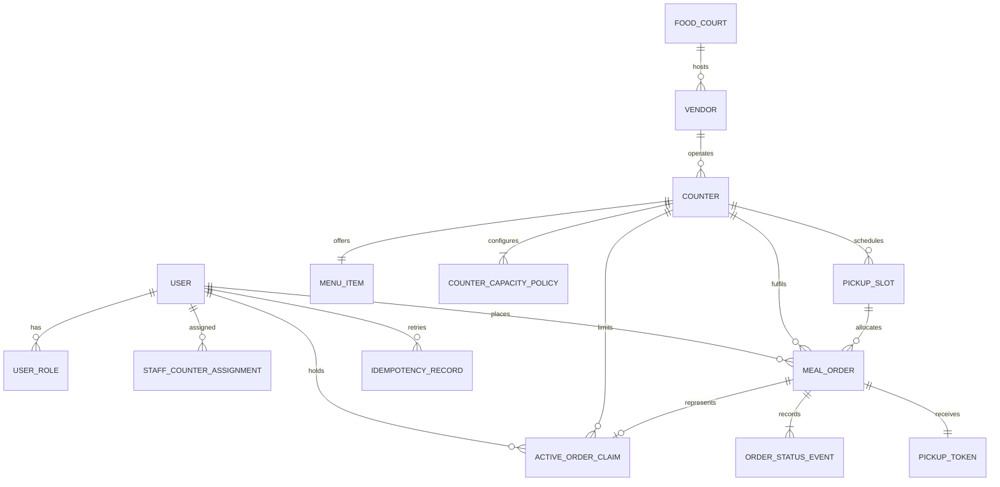

# Xeats backend contract and domain rules

Status: **Phase 0, chunk 0.1 complete.** This is the implementation contract for the backend. It records the user decisions that supersede conflicting requirements in `Xeats.md`, then makes the remaining baseline choices explicit. `openapi.yaml` is the machine-readable HTTP contract. Changes to the rules below require an explicit plan/spec update rather than an undocumented implementation choice.

## Product rules

- Hierarchy: food court → vendor → counter → one currently assigned food item. A counter owns the pickup point. A staff account may be assigned to multiple counters; each counter may have multiple staff.
- One order is exactly one meal from exactly one counter. The server resolves its item and price. No client-provided quantity, cart, cross-counter order, cash/payment API, or payment credentials.
- One employee may hold at most one active order per counter. Orders at different counters may be active simultaneously. Active states are `ACCEPTED`, `PREPARING`, and `READY`; terminal states are `COLLECTED` and `EXPIRED`.
- A valid confirmation is immediately `ACCEPTED`, marked `SIMULATED_SUCCEEDED`, and assigned one unique pickup code. There is no pending approval, rejection, or cancellation.
- Staff advance an order through `PREPARING` and `READY`. Only assigned counter staff may collect an order, only when `READY`, using its code, exactly once.
- Assigned staff may manually expire any active order with a reason. The system never expires orders automatically. An overdue order remains active until collection or manual expiry. Terminal actions release the employee/counter active-order claim; they do not return capacity to the original pickup window.
- Item availability has exactly `AVAILABLE` and `SOLD_OUT` values. Sold out blocks new confirmations, without changing accepted orders. There is no numeric stock count or stock reservation. A separate counter `acceptingOnlineOrders` switch and opening hours let staff close new online admissions while still fulfilling existing orders.
- Pickup time selection is optional in the employee experience: options show the recommended earliest feasible window by default, with later selectable windows. The API requires the displayed slot ID during confirmation, whether it was the default or one the employee chose. A stale/filled selection returns a conflict and refreshed options; never silently move an order.
- A `READY` order can be collected before its selected window begins. The slot capacity remains committed. Employees collect at the counter that sells the item; there is no pickup-spot choice.
- Accounts and fixtures are fictional, enabled only in demo/test profiles. Payment is simulated. No production directory, SSO, HR, network, or payment integrations are in scope.

## Relationships and persistence



UUID primary keys are the default for externally referenced entities. Use database foreign keys, `NOT NULL`, unique indexes, and checks wherever MySQL supports the invariant. Create a counter with exactly its one meal, initial capacity policy, and hours in one transaction. Money is integer minor units with an ISO currency code; the baseline demo accepts INR only. UTC instants are persisted and returned as RFC 3339 timestamps with offsets. Campus business dates/hours use `Asia/Kolkata`.

| Table | Required fields and constraints |
|---|---|
| `app_user` | `id`, unique case-normalized `username`, password hash, enabled, created time |
| `user_role` | `(user_id, role)` primary key; roles `EMPLOYEE`, `VENDOR_STAFF`, `DEMO_ADMIN` |
| `staff_counter_assignment` | `(user_id, counter_id)` primary key; many-to-many assignment |
| `food_court` | `id`, unique code, name, local timezone, active |
| `vendor` | `id`, `food_court_id`, name, service model label, active; MVP vendor belongs to one food court |
| `counter` | `id`, `vendor_id`, name/label, pickup instructions, accepting-online-orders, active |
| `menu_item` | `id`, unique `counter_id`, name, optional description/category, price-minor, currency, availability; no quantity/stock columns |
| `counter_opening_interval` | counter, ISO weekday, local opening time, local closing time; intervals must not overlap or have zero length; overnight intervals end on the next local date |
| `counter_capacity_policy` | counter, revision, effective time, slot minutes, total meals/slot, walk-in percent, minimum preparation seconds, maximum advance minutes, service seconds/meal |
| `pickup_slot` | `id`, `counter_id`, policy revision, UTC start/end, total capacity snapshot, online capacity snapshot, confirmed allocation count; unique `(counter_id, start_at)`; half-open interval `[start,end)` |
| `meal_order` | `id`, employee, counter, slot, single item/name/price/currency/location snapshots, enum status, version, simulated payment marker, placed/accepted/preparing/ready/collected/expired times and `expired_reason`; report indexes on `(counter_id, placed_at/accepted_at/collected_at/expired_at)` |
| `active_order_claim` | `(employee_id, counter_id)` primary key and unique `order_id`; exists exactly while the order is active; create it with the order and remove it on collection/expiry |
| `pickup_token` | `order_id` primary key, unique 10-character Crockford Base32 pickup code, issue/redeem time; raw code is returned only to that employee and accepted only in a counter-scoped redemption request; never log it |
| `order_status_event` | order, monotonically increasing order version, nullable previous status on version 1, new status, actor, UTC time, optional expiry reason; unique `(order_id, version)` and written with its state change |
| `counter_change_event` | counter, actor, changed field, previous/new value, UTC time; operational audit of availability, menu, and capacity changes |
| `idempotency_record` | employee, operation (`CREATE_ORDER`), UUID key, canonical request SHA-256 fingerprint, order reference, first status and creation time; unique `(employee_id, operation, key)`; retain with historical order |

There is no order-line table. The `counter_id`/`menu_item.counter_id` relationship and unique constraint make the one-item-per-counter rule enforceable. Editing an item changes discovery and new orders; it never changes the item/price snapshot on an existing order. Deactivate referenced locations/items rather than deleting historical records. Deactivating a counter hides it from employee discovery and stops new orders; assigned staff can still fulfill outstanding commitments. A displayed pickup token must be recoverable on an authorized owner-scoped read, so store it in the restricted token table; hash application passwords normally.

## Identity, authorization, and errors

Use one server-side session cookie (`JSESSIONID`, `HttpOnly`, `SameSite=Lax`, `Secure` in the deployed profile). A same-origin `/api` proxy will expose the two future web apps and `/api/v1`. Fetch `/auth/csrf` before login and send its session-bound token in `X-XSRF-TOKEN`; successful login and logout clear that token, so fetch a fresh one after either action before the next mutation. Angular requests send browser credentials; same-origin `EventSource` uses the session cookie automatically. Mutations use CSRF protection; logout invalidates the session. Never accept a caller-supplied employee identity for an employee operation. The server takes identity from the session.

| Operation | Employee | Vendor staff | Demo admin |
|---|---|---|---|
| Read active configured courts/vendors/counters and order options | Authenticated | Authenticated | Authenticated |
| Create/read own order and view its own token | Own orders only | None | None by default |
| Read/advance/expire/redeem orders | None | Only assigned counters | None unless separately assigned as staff |
| Change one assigned counter's item, availability, hours, capacity, or admission switch | None | Assigned counters | Allowed |
| Create/deactivate structure and assign staff | None | None | Yes |
| Read demand/dashboard reports | None | Assigned counters only | All demo counters |
| SSE | Own order changes plus public counter availability/slot changes | Changes/workload on assigned counters | Demo-wide operational changes |

Authorization is checked for each request and again for every event subscription. A staff user may have zero, one, or many counter assignments. A dashboard aggregates only explicitly assigned counters. Hidden buttons do not replace server-side access checks.

Redemption failures are rate-limited per authenticated staff account and counter. After 10 failed code attempts in a rolling minute, pause further attempts for one minute and return 429; a successful redemption clears that counter's failure count. Login throttling uses the same generic 401 response for unknown and known usernames. The single-instance foundation defaults to 10 attempts per username/IP in one minute followed by a one-minute lockout; the window and limits are deployment-configurable.

Errors follow RFC 9457 Problem Details with an additional stable Xeats `code`, safe user-facing `detail`, optional field errors, and optional refreshed `orderOptions`. They never disclose other employees or secrets. Shared codes: `UNAUTHENTICATED`, `FORBIDDEN`, `VALIDATION_ERROR`, `NOT_FOUND`, `CONFLICT`, `COUNTER_CLOSED` (inactive/outside hours), `ORDERING_PAUSED` (staff closed online admission), `ITEM_SOLD_OUT`, `ACTIVE_ORDER_EXISTS`, `SLOT_UNAVAILABLE`, `IDEMPOTENCY_KEY_REUSED`, `INVALID_ORDER_TRANSITION`, `INVALID_OR_UNAVAILABLE_TOKEN`, `PRECONDITION_FAILED`, `RATE_LIMITED`, `METHOD_NOT_ALLOWED`, and `INTERNAL_ERROR`. Use 401 for missing/expired session, 403 for an authenticated but unauthorized action, 404 for missing or out-of-scope resources, 405 for an unsupported HTTP method, 409 for stale/conflicting state, 412 for a stale `If-Match`, 422 for well-formed but invalid transition/value, and 500 for an unexpected server failure with a generic safe detail. A `409 SLOT_UNAVAILABLE` includes refreshed selectable options and the current recommendation.

## State transitions and concurrency

| Current state | Action | Actor and guard | Next state / effect |
|---|---|---|---|
| None | Confirm order | Authenticated employee; counter accepts online orders, item is `AVAILABLE`, counter is open, slot is feasible and has online capacity, employee has no active claim for counter | `ACCEPTED`; create order, one slot allocation, token and active claim atomically |
| `ACCEPTED` | Begin preparation | Staff assigned to order counter; matching current `If-Match` order version | `PREPARING`; record time/version/event |
| `PREPARING` | Mark ready | Assigned staff; current version | `READY`; record actual ready time/version/event |
| `READY` | Redeem token | Assigned staff at matching counter; token matches order; token unused | `COLLECTED`; atomically mark token redeemed, release active claim, record times/version/event |
| `ACCEPTED`, `PREPARING`, or `READY` | Expire | Assigned staff; required explanation; current version | `EXPIRED`; invalidate token, release active claim, retain slot allocation, record reason/time/version/event |

There is no other transition. `READY` may be collected early. An active order after its pickup window is still active and is tagged `overdue` in projections; no timer or background job expires it. Repeated or out-of-order staff actions cannot overwrite newer state.

Staff order queues sort by `(pickupWindow.startAt, estimatedReadyAt, placedAt, orderId)` and paginate stably. The counter summary includes active counts by state and overdue count. A separate capacity view shows every future slot's online capacity, allocated position count, remaining positions, walk-in capacity reserved, and approximate unready workload. It never labels the reserved walk-in portion as a measured count of actual walk-ins.

Order creation requires an `Idempotency-Key` UUID. It is scoped by employee and operation. Fingerprint canonical validated JSON (counter ID and the exact displayed slot ID). The same key and same fingerprint, at any later lifecycle stage, returns the original order and same code (201 on first success; 200 with `Idempotency-Replayed: true` on replay). The same key with a different fingerprint returns `409 IDEMPOTENCY_KEY_REUSED`. Do not save an idempotency record for a rejected request, so the employee can retry a corrected request with the same key after a failure that created no order. Once successful, retain the mapping with history.

All order-admission and counter-operation transactions use the same row-lock order: `counter -> pickup_slot (ascending start_at when several) -> meal_order -> pickup_token -> active_order_claim`. Read immutable order/counter identifiers first, without a lock, then acquire and re-check rows in that order. Order creation reads the idempotency mapping, locks the counter and selected slot, and rechecks the mapping. The counter lock serializes active-claim creation and release at that counter, so creation checks for an existing `(employee,counter)` claim while holding it, then inserts the order and token before inserting the claim (the claim's order foreign key must already exist). The successful idempotency mapping is inserted in the same transaction. If a duplicate idempotency key wins concurrently from a request for another counter, roll back the losing transaction completely, reload the winner, and replay or return `409 IDEMPOTENCY_KEY_REUSED` based on its fingerprint. No transaction acquires the domain rows in reverse order. Slot generation and capacity revision changes lock the counter before slot rows. Staff mutations carry `If-Match: "<orderVersion>"`; stale versions return 412 with the latest order projection in `currentOrder`. Unique constraints are the final defense, not replacements for locking. Retry/recover known MySQL deadlocks/serialization failures a bounded three times with short jitter; never return success until commit.

Placement transaction: resolve any committed idempotency replay; lock the counter and confirm active/accepting/admission, open hours, and item availability; recheck idempotency; lock and revalidate the selected slot and capacity snapshot; reject if an `(employee,counter)` active claim exists; insert one accepted order/payment marker, issue its token, insert the active claim, increment that slot's confirmed allocation once, append the version-1 event, and persist the idempotency mapping; commit. A concurrent duplicate idempotency-key constraint failure rolls back every tentative write before resolving the winning mapping. Any other conflict rolls back every write. If sold-out races an order, the counter row serializes the changes: whichever write commits first defines whether that order was valid. Availability change does not erase or cancel previously accepted commitments.

Collection/expiry transactions serialize at the counter/order and commit exactly one terminal state. A terminal action removes the active claim and invalidates token redemption. It never decrements `confirmed_allocation_count`. Retries of order creation do not increment the slot a second time.

## Capacity, pickup options, and ETA formula

These values are proposed seeded demo defaults for newly configured counters. Staff can configure them; chunk 0.1 chooses these small, legible ranges so there is a reproducible contract:

| Setting | Initial default | Allowed range |
|---|---:|---:|
| Pickup slot duration | 5 minutes | 5–30 minutes, increments of 5 |
| Total counter capacity | 6 meals per slot | 1–200 |
| Capacity reserved for walk-ins | 30% | 0–100%, whole percentage |
| Minimum preparation lead | 2 minutes | 0–30 minutes |
| Advance order horizon | 60 minutes | 15–1,440 minutes |
| Service time per meal | 75 seconds | 15–600 seconds |

Centralized initial currency is `INR`. Example hours are 11:00–14:00 `Asia/Kolkata`, Monday–Saturday. Counters may configure other weekday intervals; same-day and overnight intervals are supported. Intervals use local time, must be nonempty/nonoverlapping, and end exactly on a slot-duration boundary. An interval's closing end is exclusive. Overnight intervals are attributed to the weekday they open. Generate future slots idempotently with unique `(counter,start)` and interpret DST with the venue timezone rules.

For one slot, `onlineCapacity = floor(totalMeals * (100 - walkInPercent) / 100)`. A slot with zero online capacity is visible as unavailable. If a slot already has `n` confirmed allocations, its next candidate's one-based position is `j=n+1`; positions are never reused, including after early collection or manual expiry.

For a selected pickup window, with slot duration `D` seconds, online capacity `K`, now `T`, minimum preparation lead `L`, and configured per-meal service `S`, calculate:

```text
plannedSlotTime = slot.start + floor((2*j - 1) * D / (2*K)) seconds
earlierUnready = count of orders at this counter that are ACCEPTED or PREPARING
                 and sort ahead by (slot.start, createdAt, orderId)
estimatedReadyAt = max(plannedSlotTime, T + L + earlierUnready*S)
```

For a quote, the hypothetical new order sorts after existing reservations in the selected slot. Workload counts earlier commitments across that counter and includes `PREPARING` conservatively as one full service unit. It excludes READY, COLLECTED, and EXPIRED orders. Slot positions still account for terminal reservations; therefore early collection/expiry can free an employee's next order but never expand that slot's online capacity. A quote is selectable only if: the counter and item are accepting orders, the slot is inside configured opening hours and the advance horizon, `slot.start >= T+L`, `j <= K`, and `estimatedReadyAt < slot.end`. Windows are half-open `[start,end)`. Equality with the closing boundary is too late. Times are recomputed on both quote and confirmation.

This formula is an approximate slot-readiness projection, not a promise of handover or a kitchen measurement. Return both the assigned pickup interval and `estimatedReadyAt` with `estimateIsApproximate: true`. Return `expectedOnsiteWaitMinutes: null` and `onsiteWaitUnavailableReason: "WALK_IN_AND_HANDOVER_TIMES_NOT_MEASURED"` until evidence supports a physical-wait estimate. Slot capacity remains authoritative even if the formula estimates that another order might be prepared sooner.

The same projection is used in quote, employee-order, staff-queue, and staff-capacity responses. It is recomputed from the committed orders at read time and the slot's immutable capacity/policy snapshot. `estimateIsApproximate` is true when `estimatedReadyAt` is projected from current workload and false when the response uses an actual `readyAt` or has no estimate. ACCEPTED and PREPARING orders contribute one full service unit to later commitments; READY orders contribute no backlog and expose their recorded `readyAt`; COLLECTED orders also retain their actual `readyAt`; EXPIRED orders without a ready timestamp expose a null estimate and do not contribute workload. Terminal reservations still occupy their original allocation position when estimating later orders in that same slot. For a candidate in a slot, all existing active orders in earlier slots and that same slot count ahead of it, because a new allocation sorts after existing reservations. `StaffCapacityWindow.unreadyEarlierOrders` counts only strictly earlier pickup windows, while its `estimatedLatestReadyAt` summarizes active commitments booked in that window. None of these projections changes an accepted pickup window or increases the capacity stored on a slot.

Staff queue `due` counts active orders whose pickup window has started and not ended (`startAt <= now < endAt`). `overdue` counts active orders whose window has ended (`endAt <= now`); the two counts do not overlap. Readiness and physical handover wait remain separate values: order and capacity responses always return a null `expectedOnsiteWaitMinutes` with `WALK_IN_AND_HANDOVER_TIMES_NOT_MEASURED` until walk-in and handover measurements exist.

### Hand-checkable examples

Use `D=300s`, total capacity 6, walk-in 30%, `K=4`, `L=120s`, `S=75s`, with the example counter opening from 11:00 to 14:00 IST:

| Scenario (all examples on the same service day, IST) | Calculation | Result |
|---|---|---|
| Empty slot 12:00–12:05; now 11:55; first position | Online cap 4. `planned=12:00:37`; `T+L=11:57`; ready estimate is the later value | Selectable; 12:00–12:05 pickup; approx ready 12:00:37 |
| Next position in that slot | `floor(3*300/8)=112s` after 12:00 | Approx ready 12:01:52 |
| Fourth position in that slot | `floor(7*300/8)=262s` after 12:00 | Approx ready 12:04:22; selectable |
| Fifth request for same slot after four confirmed allocations | `j=5 > K=4`; allocation is frozen even if a prior meal is collected/expired | Full; return conflict if it was submitted as the selected slot |
| Selection optional in UI | Options recommend the earliest selectable slot; employee may pick a later selectable slot | Client confirms with that displayed slot UUID |
| Six active unready orders committed ahead of candidate; selecting empty 12:00 window at 11:55 | `T+120+6*75 = 12:04:30`; planned first position is 12:00:37 | Candidate selectable with approx ready 12:04:30 |
| Seven such earlier orders for 12:00 window | `T+120+7*75 = 12:05:45`, which is not `< 12:05` | Window infeasible, offer next selectable window if its estimate fits |
| Walk-in reserved 100% | `floor(6*0/100)=0` | Online ordering unavailable for that slot |
| Closing boundary 14:00 | Last 5-minute window is 13:55–14:00; no slot starts at 14:00 or ends after 14:00 | Closing is exclusive |
| Counter/item marked sold out | GET quote returns no selectable windows and `noOptionsReason: ITEM_SOLD_OUT`; confirming a prior selection returns a conflict | Existing accepted orders keep their states/slots |
| Order window passes without pickup | State remains active; overdue flag is true | Employee cannot create another order at that counter until collection or staff expiry |
| Staff expires that overdue order | State becomes `EXPIRED`; active claim/token released/invalidated; prior slot position retained | Employee may create another order at that counter if open, available, and a later slot fits |
| Meal is READY at 11:58 for a 12:00 window | Assigned staff redeems its token; timing is not a blocker | Collected before window; original slot position remains consumed |

When a requested slot is full, old, closed, newly infeasible, or counter configuration changed, respond 409 with a stable code and refreshed recommended/available options. GET quotes never reserve capacity. A later option is merely a proposal until the order transaction commits.

## API, live events, and reporting

`openapi.yaml` defines exact paths, request/response schemas, security/CSRF headers, filters, pagination, errors, and SSE format. Its reusable rules are:

- `/api/v1`; JSON camelCase DTOs; IDs are UUIDs; timestamps RFC 3339; money is `{amountMinor, currency}`.
- Server-side cookie session plus CSRF. Employee identity is never supplied in an order path/body. State-changing staff actions use `If-Match` order version.
- Employee list/detail is scoped to the authenticated employee. Staff queue/mutations/reports are scoped to assigned counter IDs. `DEMO_ADMIN` can seed structure. Disclose neither another user's identity nor token.
- Confirmation accepts exactly `{counterId, pickupSlotId}` and an `Idempotency-Key`; no item ID, quantity, amount, employee ID, location choice, or payment credential is trusted from the client.
- A new order returns 201; same-key replay returns 200 with the original body and code. Slot conflict is 409 with fresh options. No “best effort” fallback.
- Token code is 10 random Crockford Base32 characters. Redemption body contains the code and uses the counter ID in its path; only `READY` orders redeem. Never use a token as an employee login/session credential, send it in SSE, or include it in logs.
- SSE sends only committed notification IDs, versions, and public change types. Employees get their own order changes plus public availability/capacity changes. Staff get assigned-counter changes. Payloads contain no code or personal data. After reconnect, re-fetch snapshots; event replay is not promised.
- `GET /api/v1/staff/counters/{counterId}/report` requires an assigned counter and accepts inclusive `startDate`/`endDate` dates in that counter's food-court timezone, for at most 31 local dates. Each count/value is bucketed by its corresponding lifecycle event timestamp; hourly demand uses `placedAt` and returns 24 local-hour bins. Collected meals group by immutable item name and price snapshots, so menu edits do not rewrite history. On-time collection means collected before the pickup window's exclusive end. Lifecycle summaries use collected orders whose `collectedAt` is in range; they include sample count, average minutes, and nearest-rank p95, with null average/p95 when no valid sample exists. Accepted/collected values are separately labelled simulated order values, never settlement or revenue.

## Risks and evidence gates

| Risk | Required mitigation/evidence |
|---|---|
| Concurrent order oversubscription | MySQL row locks plus uniqueness/check constraints; many employees race for final slot, same employee races same counter, different counters remain independent |
| Duplicate submit after a lost response | Required idempotency UUID and fingerprint; test replay before and after terminal state; ensure capacity count increments once |
| Sold-out/change-versus-order race | Serialize on counter row; test either commit order and prove existing obligations remain |
| Invalid/replayed/wrong-counter pickup | Counter-assignment auth + ready-state guard + atomic token redeem; race simultaneous redemption and expiry |
| Stale pickup options/config changes | Freeze slot capacity/policy per materialized slot; revalidate selected slot in confirmation; return 409 refreshed options |
| Weak token or information leakage | 50-bit cryptographically generated code plus collision constraint; role/owner-scoped reads, throttled redemption, request-body/SQL/event redaction |
| Backlog creates misleading ETA | Exact formula and fixtures above; late readiness visible; don't promise physical wait; test capacity/ETA separately |
| Staff work across several counters | Many-to-many assignment; manually configure separate capacity for shared staff; explicitly no automatic labor pooling in MVP |

The first real backend build must demonstrate the happy journey using employee/staff HTTP sessions; one employee's permitted and denied reads; manual expiry/no auto-expiry; two-counter ordering; full/sold-out conflicts; MySQL migrations; simultaneous final-slot and active-order races; idempotent replay; token redemption once at the correct counter; and SSE commit/scoping/reconnect behavior. Do not label the local prototype a measured pilot or production deployment.
